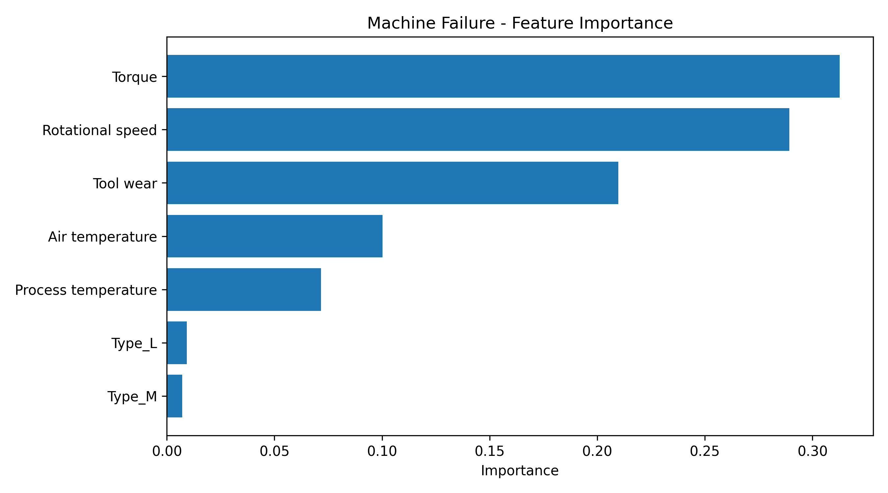
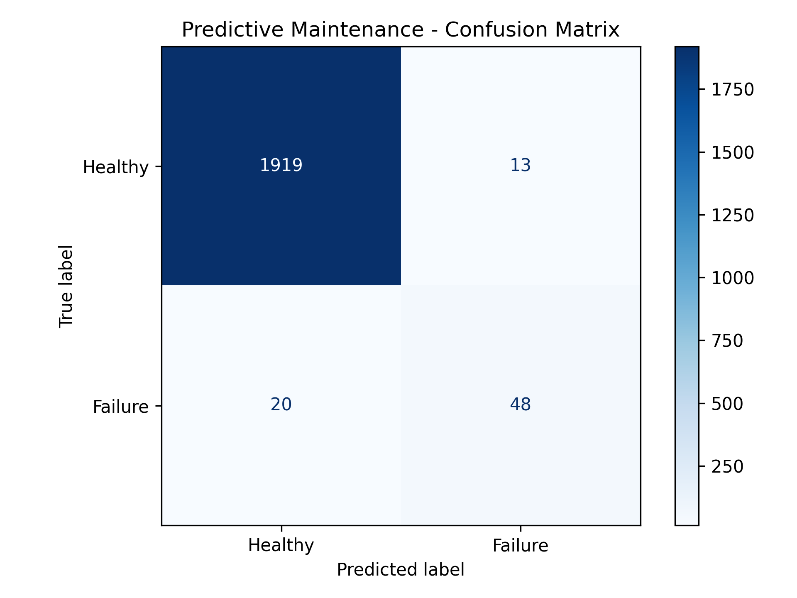

# AI-Based Predictive Maintenance System

## Project Overview
This project develops a machine learning-based predictive maintenance prototype to identify potential machine failures using operational sensor data.

The objective is to explore how machine learning can support maintenance planning by identifying patterns associated with equipment failure.

## Dataset
- **Dataset:** AI4I 2020 Predictive Maintenance Dataset
- **Source:** [UCI Machine Learning Repository](https://archive.ics.uci.edu/dataset/601/ai4i+2020+predictive+maintenance+dataset)
- **Records:** 10,000
- **Input features:** Air temperature, process temperature, rotational speed, torque, tool wear, and machine type.
- **Target:** Machine failure

The dataset is synthetic and intended for research and learning.

## Technologies Used
- Python
- Google Colab
- Pandas
- NumPy
- Matplotlib
- Scikit-learn
- Random Forest Classifier

## Project Workflow
1. Data loading and exploration
2. Data preprocessing and categorical encoding
3. Training and testing data split
4. Random Forest model training
5. Model evaluation
6. Feature importance analysis
7. Prediction threshold experimentation

## Model Performance

The model was evaluated using a 20% test split.

| Metric | Default threshold (0.50) | Adjusted threshold (0.30) |
|---|---:|---:|
| Accuracy | 98.1% | 98.4% |
| Precision | 94.1% | 78.7% |
| Recall | 47.1% | 70.6% |
| F1-score | 62.7% | 74.4% |

The adjusted threshold improved failure detection recall, while reducing precision. This illustrates the trade-off between detecting more failures and generating false alarms.

**Evaluation note:** The 0.30 threshold was explored using test-set predictions, so these adjusted results are exploratory rather than an independent final evaluation.

## Feature Importance

The Random Forest model identified the following influential features:

- Torque
- Rotational speed
- Tool wear
- Air temperature
- Process temperature

Feature importance reflects the model's relative reliance on each feature, not proof of causation.

## Confusion Matrix

## Repository Contents
- `AI_Predictive_Maintenance.ipynb` — Complete project notebook
- `feature_importance.png` — Feature importance visualisation
- `confusion_matrix.png` — Model evaluation visualisation

## Limitations and Future Improvements
- The dataset is synthetic and may not represent real industrial operating conditions.
- Threshold selection should be performed using a separate validation set.
- Future work could include testing additional classification algorithms, model validation, and deployment through a simple monitoring interface.

## Conclusion
This project demonstrates how machine learning can be applied to predictive maintenance and how classification thresholds influence failure detection performance.

**Project Type:** Machine Learning | Predictive Maintenance | Industrial Analytics
